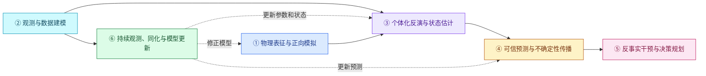

# 物理 AI 方法知识图谱 · Physics AI Methods Atlas

**[简体中文（默认）](README.md) | [English](README.en.md)**

> 一张以**科学研究闭环为主轴、方法演化 DAG 为分支**的动态知识图谱，服务于 ODE/PDE 反问题、物理 AI、冠脉血流动力学、患者特异数字孪生与反事实决策。

我们关注的不是尽可能多地收藏论文，而是：**链路需要什么能力？方法提供什么功能？新方法相对前驱改变了什么、解决了什么瓶颈？哪些论文最值得先读？**

## 一、统一研究主轴



主轴表示**研究能力的逻辑关系**，不是固定执行顺序：正向模拟可能在反演、预测和干预中被反复调用，而新观测会触发反馈更新。

## 二、主轴与方法演化 DAG 的关系

**方法家族不属于某个唯一环节。** 各研究环节通过有向**功能边**指向相关方法家族或具体方法，边上说明它们承担的作用。

例如，正向模拟环节使用神经算子学习参数到物理解的映射；反演环节可以把神经算子用作可微正向代理；预测环节可以在验证过的输入分布内利用它快速预测。三个环节指向的是**同一个神经算子家族**，不是三个重复实体。

方法家族内部是分类树/演化 DAG。分类（`specializes`）、方法改进（`extends`）、融合（`combines`）和学习依赖（`depends_on`）使用不同关系。对于真正的改进/融合边，记录：

- **改变了什么**（技术机制）
- **解决什么瓶颈**（研究动机）
- **代价与适用边界**
- **直接支撑的论文**
- **对应哪些研究环节**，并用主要环节的颜色表示边的关注方向

物理一致性、可辨识性、数值/模型误差、不确定性校准和外部泛化是**跨环节质量关注点**，不是又一个线性步骤。

## 三、当前 v0.3 的建设边界

| 模块 | 状态 |
|---|---|
| 研究主轴 | 6 个环节、双输入汇合及更新反馈 |
| 方法家族 | 20 个家族与子家族；允许多重成员关系 |
| 原有方法 | 保留30个方法节点、32篇论文/章节、8本专著、10个研究问题 |
| 横向关注点 | 5类跨环节可信性问题 |
| 演化边 | 原有10条改进/融合关系均补充变化、瓶颈、环节映射 |
| 尚待系统整理 | 生成式物理建模、传统数值离散、可微物理模拟、最优控制与世界模型等 |

**planned 只表示目前尚未完成本知识库的系统整理，不代表该领域缺少成熟研究。** 当前不为凑节点而伪造论文与方法关系。

## 四、从这里开始

- **[统一图谱架构（中文）](docs/zh/UNIFIED_GRAPH.md)**：主轴、方法家族、功能边、演化边、颜色及边界。
- **[方法目录（30个已有节点）](docs/METHOD_CATALOG.md)**：现有方法与文献索引（内容逐步双语化）。
- **[最小阅读路径](docs/READING_GUIDE.md)**：优先少量 Landmark 或优质教材章节，不设强制数量。
- **[建设路线图](docs/ROADMAP.md)**：搭建架构 → 补全方法和文献 → 用小图验证 → 正式交互可视化。

Landmark 是论文**对具体方法的学术贡献关系**，Start Here 只是**可选的优先阅读建议**。

## 五、数据与检查

```text
data/stages/         研究主轴（环节自有颜色）
data/families/       方法家族与分类 DAG
data/methods/        具体方法；不因跨环节复用而复制
data/relations/      功能角色、演化机制、瓶颈及文献证据
data/concerns/       跨环节质量问题
data/{papers,books,problems,areas}/  原有资料与研究问题
locales/zh-CN.json   原方法名称中文翻译（不复制学术事实）
scripts/export_unified.py           为未来界面生成中英文投影
```

```bash
python -m pip install -r requirements-dev.txt
python -m scripts.validate
python -m pytest -q
python -m scripts.export_unified --lang zh --output build/unified-zh.json
python -m scripts.export_unified --lang en --output build/unified-en.json
```

目前尚未完成交互式 GitHub Pages；上述 Mermaid 只是研究主轴示意。科学知识数据先建立正确，再扩充文献，最后完成正式可视化。

[完整架构说明](docs/zh/UNIFIED_GRAPH.md) · [English architecture](docs/en/UNIFIED_GRAPH.md) · [维护规范](docs/CONTRIBUTING.md)
