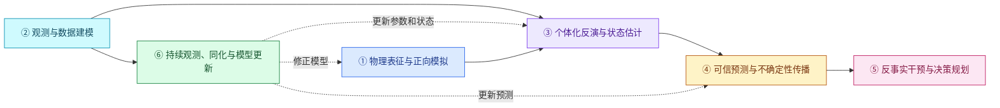

# 物理 AI 方法知识图谱 · Physics AI Methods Atlas

**[简体中文（默认）](README.md) | [English](README.en.md)**

> 一张以**科学研究闭环为主轴、方法演化 DAG 为分支**的动态知识图谱，服务于 ODE/PDE 反问题、物理 AI、冠脉血流动力学、患者特异数字孪生与反事实决策。

我们关注的不是尽可能多地收藏论文，而是：**链路需要什么能力？方法提供什么功能？新方法相对前驱改变了什么、解决了什么瓶颈？哪些论文最值得先读？**

## 一、统一研究主轴



主轴表示**研究能力的逻辑关系**，不是固定执行顺序：正向模拟可能在反演、预测和干预中被反复调用，而新观测会触发反馈更新。

## 二、主轴与方法演化 DAG 的关系

**方法家族不属于某个唯一环节。** 各研究环节通过有向**功能边**指向相关方法家族或具体方法，边上说明它们承担的作用。

例如，正向模拟环节使用神经算子学习参数到物理解的映射；反演环节可以把神经算子用作可微正向代理；预测环节可以在验证过的输入分布内利用它快速预测。三个环节指向的是**同一个神经算子家族**，不是三个重复实体。

方法家族内部是分类树/演化 DAG。分类（`specializes`）、方法改进（`extends`）、融合（`combines`）和学习依赖（`depends_on`）使用不同关系。对于真正的改进/融合边，记录：

- **改变了什么**（技术机制）
- **解决什么瓶颈**（研究动机）
- **代价与适用边界**
- **直接支撑的论文**
- **对应哪些研究环节**，并用主要环节的颜色表示边的关注方向

物理一致性、可辨识性、数值/模型误差、不确定性校准和外部泛化是**跨环节质量关注点**，不是又一个线性步骤。

## 三、v0.4 学术内容补强（2026-11-17）

| 数据内容 | 当前规模 |
|---|---:|
| 研究主轴 / 跨环节关注点 | 6 / 5 |
| 方法家族 / 具体方法 | **34 / 61** |
| 论文记录 / 专著 | **58 / 12** |
| 研究问题 / 有类型关系 | **15 / 530** |

v0.4 在原先30个方法基础上新增了31个节点，并保留同一数据源与文献证据关系：

- **传统数值计算**：有限差分、有限体积、有限元、Runge–Kutta，使用权威教材作学习入口。
- **反问题与贝叶斯计算**：可辨识性、MCMC、NUTS、变分推断、仿真驱动推断（SBI）、模型失配。
- **神经算子新架构**：多极图神经算子、Galerkin Transformer，以及独立的 MeshGraphNets 学习型模拟分支。
- **生成式物理 AI / 生成式反问题**：VAE、GAN、归一化流、扩散、Score-SDE、Flow Matching、扩散后验采样、物理信息扩散等。
- **世界模型与干预规划**：PlaNet、Dreamer、MPC、MBPO、离线 RL 的 CQL；对应的冠脉干预用途目前只是**候选研究方向，不代表临床验证**。
- **可信性与观测设计**：多项式混沌不确定性传播、贝叶斯模型失配、贝叶斯实验设计。

**这是一套首批有代表性论文支撑的方法谱系，不是宣称物理 AI 已全面覆盖。** 冠脉0D/1D/3D耦合模型、临床观测机制、严谨的后验校准与干预验证仍待补充。

## 四、v0.6：统一方法网络设计原型（新）

**[查看 v0.6 使用说明](viewer-v06/README.md)** · [统一图谱的页面源码](viewer-v06/index.html)

根据原型反馈，已从 v0.5 的三条独立谱系切换为**同一张方法图，所有61个方法只出现一次**。每个研究环节现在有明确的 **“环节 → 方法家族/具体方法 → 功能说明”** 映射区，选择环节后，全局图中直接相关和家族级关联的方法采用不同高亮，其余节点淡化但不消失。

六个浅色区域只是帮助导航，**不决定方法的唯一家族**。跨区演化边、分类 DAG、多重家族标签、Landmark、Start Here 和证据仍然基于原始数据。

最新成功构建的 **离线交互预览**可从 [GitHub Actions · Validate atlas data](https://github.com/TianminWang/physics-ai-methods-atlas/actions/workflows/validate.yml) 的 Artifacts 下载 `atlas-unified-v06`，解压后直接打开 `index.html`。

**现阶段请重点评估：** 主轴与方法的映射是否足够清楚；方法分区是否合理；图谱过密时折叠、聚焦和展开是否易用。尚未发布正式 GitHub Pages。

## 五、v0.5：交互式布局验证原型（历史版本）

**[原型使用说明](prototype/README.md)** · [界面源文件](prototype/index.html)

已为**传统反问题、神经算子、生成式反问题**三条真实谱系构建交互原型。它从权威知识库导出方法和文献，支持研究环节筛选、精简/完整节点展开、方法演化边的瓶颈说明、Landmark 引用、中英文切换、搜索及手机端拖动。

最新成功构建的离线预览，可从 **[GitHub Actions · Validate atlas data](https://github.com/TianminWang/physics-ai-methods-atlas/actions/workflows/validate.yml)** 的 Artifacts 下载 `atlas-interactive-layout-v05`，解压后直接双击 `index.html`。浏览器截图见 **[Prototype UI smoke](https://github.com/TianminWang/physics-ai-methods-atlas/actions/workflows/prototype-ui.yml)**。

**本阶段验证的是布局与交互，不是完整 GitHub Pages 网站。** 全量知识图谱的交互网站将在确认原型可读后扩展。

## 六、从这里开始

- **[统一图谱架构（中文）](docs/zh/UNIFIED_GRAPH.md)**：主轴、方法家族、功能边、演化边、颜色及边界。
- **[v0.4 方法谱系综述（中文）](docs/zh/METHOD_GENEALOGY_V04.md)**：传统、生成式、神经算子、反演及世界模型的代表方法与学术关系。
- **[v0.2 初始30节点目录](docs/METHOD_CATALOG.md)**：历史起点的节点索引，新增31个方法见 v0.4 谱系综述。
- **[最小阅读路径](docs/READING_GUIDE.md)**：优先少量 Landmark 或优质教材章节，不设强制数量。
- **[建设路线图](docs/ROADMAP.md)**：搭建架构 → 补全方法和文献 → 用小图验证 → 正式交互可视化。

Landmark 是论文**对具体方法的学术贡献关系**，Start Here 只是**可选的优先阅读建议**。

## 七、数据与检查

```text
data/stages/         研究主轴（环节自有颜色）
data/families/       方法家族与分类 DAG
data/methods/        具体方法；不因跨环节复用而复制
data/relations/      功能角色、演化机制、瓶颈及文献证据
data/concerns/       跨环节质量问题
data/{papers,books,problems,areas}/  原有资料与研究问题
locales/zh-CN.json   原方法名称中文翻译（不复制学术事实）
scripts/export_unified.py           为未来界面生成中英文投影
```

```bash
python -m pip install -r requirements-dev.txt
python -m scripts.validate
python -m pytest -q
python -m scripts.export_unified --lang zh --output build/unified-zh.json
python -m scripts.export_unified --lang en --output build/unified-en.json
```

目前尚未完成交互式 GitHub Pages；上述 Mermaid 只是研究主轴示意。已完成第一批文献与方法谱系补强，下一步是小规模图谱布局核验（v0.5），再开发正式交互可视化。

[完整架构说明](docs/zh/UNIFIED_GRAPH.md) · [English architecture](docs/en/UNIFIED_GRAPH.md) · [维护规范](docs/CONTRIBUTING.md)
